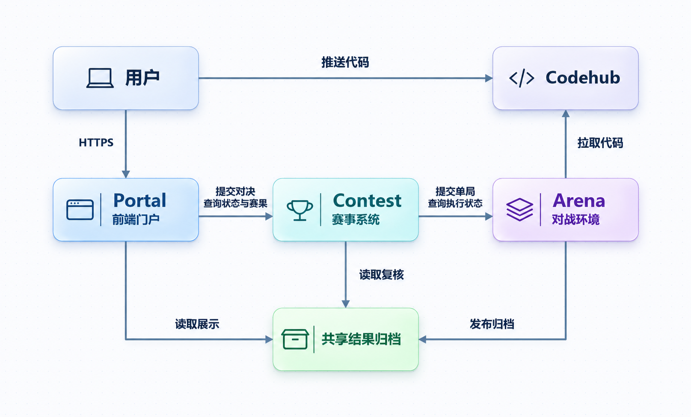

# 架构设计

## 一、架构总览



| 场景 | 发起与编排 | 结算后的处理 |
| --- | --- | --- |
| 天梯 | Portal 提交发起方和对手编号，Contest 按当前赛程配置规则并随机生成地图种子 | Portal 用受理返回的对决编号查询结算结果，更新 Elo 并展示对局记录 |
| 初赛单循环 | 主办方将 Portal 导出的截止名单导入 Contest，创建单循环 | 主办方将 Contest 导出的结果导入 Portal，由 Portal 公示 |
| 决赛淘汰赛 | Portal 按初赛排名提前编排对阵，校验主办方权限和参赛资格后通过统一的对决接口逐场下发 | Portal 将返回的对决编号关联到对应场次，查询赛果并负责对阵推进和公示 |
| 独立压测 | 主办方在独立时段上传测试名单，指定 Contest 压测批次。Contest 复用初赛编排和 Arena 提交、查询及复核流程 | 主办方查看结算进度、故障、用时和吞吐量，必要时在 Contest 结束批次。正式排名、导出和 Portal 接口只采用正式赛果 |

初赛天梯使用 `phase: "prelim-ladder"`，决赛天梯使用 `phase: "final-ladder"`，每场在同一张随机地图上换边打两局。初赛单循环使用 `phase: "prelim"`，正式决赛使用 `phase: "final"`，各用对应的固定地图池。每场三图六局，每张图的第二局换边。初赛按登记胜局降序、负局升序、队伍编号升序排名。前 16 支具备资格的队伍晋级决赛。

## 二、子系统功能

| 子系统 | 职责 |
| --- | --- |
| Portal | 赛事唯一对外入口。门户页面和业务接口通过公司 SSO 认证，按主办方权限、队伍成员关系及赛事可见性授权。负责报名、队伍管理、天梯、决赛对阵和赛果公示。 |
| Contest | 承接 Portal 对决，执行初赛及压测单循环，监控 Arena，复核归档、记录裁定并结算。负责导出初赛排名及交付裁判镜像。 |
| Arena | 固定参赛版本，按赛段准备 Bot 运行环境，在隔离环境构建并运行 Bot，提供单局执行状态和运行统计，并发布单局归档。 |

## 三、子系统间接口

Portal、Contest 与 Arena 部署在同一台 Linux 服务器，服务间调用使用本机 HTTP 地址，无需服务间令牌或认证头。Codehub 提供代码仓库服务。

- HTTP 请求体与响应体使用标准 JSON，提交的 `Content-Type` 为 `application/json`。JSON 报文和共享归档中的 JSON、JSONL 均采用 UTF-8。时间采用带 `+08:00` 的 ISO 8601 格式。
- `duel_id` 标识一次天梯挑战或一场正式对决，格式为 `duel-<唯一编号>`，后缀由英文字母、数字、下划线或连字符组成。
- `run_id` 标识单局的一次执行，格式为 `run-<局号>.<尝试次数>`。局号为数字，在共享归档中唯一，尝试次数从 1 开始。
- `team_id` 为 `team` 加三位数字，基准 Bot 编号为 `bot001`、`bot002`、`bot003`。规则赛段 `rules` 取 `prelim`（初赛）或 `final`（决赛）。
- 错误响应使用相应的 HTTP 状态码与包含稳定 `code` 的 JSON，可附 `message`。

| 交接内容 | 接口及格式 |
| --- | --- |
| Portal 提交对决 | `POST /contest/v1/duels`。天梯挑战和预编排的决赛场次均只提交含双方编号的 `sides`。Contest 持久化后以 `202` 返回 `duel_id`，Portal 按场次防止重复下发 |
| Portal 查询状态 | `GET /contest/v1/duels/{duel_id}/status` 返回 `in_progress` 或 `finished` |
| Portal 查询结算 | `GET /contest/v1/duels/{duel_id}/result` 返回整场结果、各方登记胜负局数和生效单局编号。待定时 `result` 为 `null` |
| 初赛 XLSX 交接 | Portal 导出含「队伍」表的 `队伍名单.xlsx`。Contest 确认赛果后导出含「排名」「对决」「对局」的 `初赛结果.xlsx`，Portal 导入并经主办方确认后公示 |
| Contest 下发单局 | `POST /arena/v1/runs` 携带 `run_id`、`duel_id`、`rules`、`bots`、`config.map`。Arena 持久化后返回空体 `202` |
| Contest 查询单局状态 | `POST /arena/v1/runs/query` 按 `run_id` 查询排队、执行、完成、构建失败和平台故障。初赛单循环和压测每 10 秒查询一轮，每批最多 100 个编号。天梯和正式决赛每次查询一个编号 |
| Contest 查看 Arena 运行状态 | `GET /arena/v1/status` 查询空闲、占用和停用槽位、队列长度、近期完成量和平台故障次数 |
| 裁判容器与共享归档 | 裁判读取只读 `/task/task.json`，向 `/out` 写结果、回放和日志。Arena 在 `runs/<run_id>/` 交付 `match.json`、`replay.json`、`log.jsonl`，构建日志放在 `builds/<team_id>/<run_id>.log`。Contest 和 Portal 只读 |

## 四、前端门户页面与输入材料

### 4.1 页面清单

| 页面 | 内容要素 | 可做的操作 |
| --- | --- | --- |
| 首页 | 赛题名与玩法、当前阶段与下一节点倒计时、最新公告 | 进入报名、题目、赛程 |
| 赛程安排 | 赛程及公告、初赛单循环进度、决赛淘汰赛示意 | 查看进度与规则 |
| 题目规则 | 赛题背景、基板元素图例、规则图解、胜负判定、提交格式与运行环境 | 下载选手材料包 |
| 队伍管理 | 全员名册，有所属队伍时展示本队信息、成员和仓库地址 | 报名、修改队名、办理成员变更 |
| 天梯榜 | 队名、天梯分、已完成挑战次数、胜率和本队最近一次挑战状态 | 发起挑战 |
| 对局记录 | 可按类型筛选的本队对局、支持逐回合播放和调速的回放及事件列表 | 查看历史回放，下载回放与本方日志 |
| 比赛结果 | 初赛公示结果、决赛固定对阵图及结果 | 查看赛果与有效单局回放 |

### 4.2 开发输入材料

门户采用主办方提供的视觉设计稿。

| 材料 | 用于页面 | 提供方 | 最晚交付 |
| --- | --- | --- | --- |
| 当届赛事规章 | 赛程安排 | 主办方 | 报名开放前 |
| 分赛段的题目规则、选手材料包及下载地址 | 题目规则 | Contest 负责人提供，主办方随各赛段题目发布 | 各赛段题目公布前 |
| 报名、题目公布、锁仓、单循环及决赛时间和公告 | 首页、赛程安排 | Portal 负责人按主办方发布的赛程维护 | 报名开放时 |
| 基板元素图例和规则图解用短回放 | 题目规则 | Contest 负责人 | 初赛题目公布前 |
| 三档基准 Bot 的编号和策略说明（随机、贪心、搜索） | 天梯 | Contest 负责人 | 初赛题目公布前 |
| 示例回放，包含地图、初始网格和逐回合变化 | 对局记录 | Contest 负责人 | 初赛题目公布前 |

## 五、Codehub 仓库规划

### 5.1 目录结构

```text
hackathon/                   # 顶层组，主办方管理员为 Owner
└── 2026/                    # 届次子组使用四位年份，赛后整体归档为只读
    ├── platform/
    │   ├── portal           # 前端门户页面与后端服务
    │   ├── contest          # 赛事服务、管理界面、裁判和游戏引擎
    │   ├── arena            # 对战环境服务
    │   ├── docs             # 赛事文档、接口、归档格式及运行契约
    │   └── deploy           # 部署脚本与环境配置
    ├── content/
    │   ├── player-kit       # 独立发布的选手材料包
    │   ├── baseline-bots    # 三档基准 Bot，按基准编号命名
    │   └── secret           # 封存的正式地图与未公布的决赛规则
    └── teams/
        └── teamNNN          # 单队代码仓
```

### 5.2 权限与仓库操作

| 角色 | platform/\* | content/player-kit、baseline-bots（全员可读） | content/secret | teams/teamNNN |
| --- | --- | --- | --- | --- |
| 主办方管理员 | Owner | Owner | Owner | Owner |
| 子系统负责人 | 本仓 Maintainer，其余只读 | 仅 Contest 负责人 Maintainer，其余只读 | 仅 Contest 负责人 Maintainer | 只读 |
| 队伍成员 | 无 | 只读 | 无 | 仅本队仓 Developer |

主办方按预计队伍数的 1.5 倍预建空仓，报名成功后按权限表分配代码仓和授权。各赛段提交截止时批量设为只读并记录各队 `main` 分支的最终提交，决赛练习开放时恢复推送权限。
